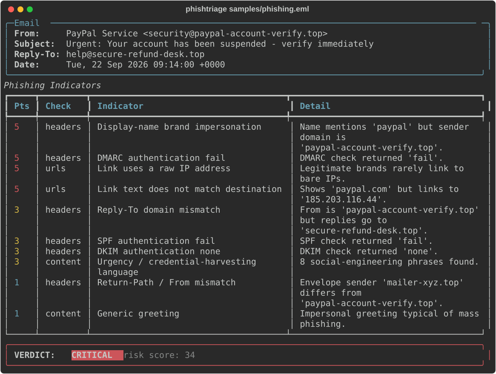

# 🎣 PhishTriage

> A phishing email (`.eml`) triage tool for SOC analysts. Scores sender spoofing, SPF/DKIM/DMARC results, malicious URLs, risky attachments and social-engineering content into a single **risk verdict**.

Phishing triage is one of the most common — and most repetitive — SOC L1 tasks. PhishTriage automates the first pass: point it at a suspicious `.eml` and it returns a scored, explainable breakdown of *why* the message is (or isn't) phishing, ready to paste into a ticket.



---

## ✨ Features

- **Header analysis** — display-name brand impersonation, Reply-To / Return-Path mismatches.
- **Authentication** — parses `Authentication-Results` for **SPF / DKIM / DMARC** pass/fail.
- **URL analysis** — raw-IP links, link-text vs destination mismatch, URL shorteners, punycode/homograph domains, suspicious TLDs.
- **Attachment analysis** — executables, macro-enabled Office docs, HTML attachments, archives, double extensions.
- **Content analysis** — urgency / credential-harvesting language, generic greetings.
- **Weighted risk score → verdict** — `LOW / MEDIUM / HIGH / CRITICAL`, with every point explained.
- **Outputs** — rich console, JSON (for SOAR/mail-gateway automation), and a standalone HTML report.
- **Automation-friendly** — exits `1` on HIGH/CRITICAL, so it can gate a mail pipeline.
- **No external services or API keys** — 100% offline, uses only the Python standard library + `rich`.

## 🚀 Installation

```bash
git clone https://github.com/defamp/phishtriage.git
cd phishtriage
pip install -r requirements.txt
pip install -e .        # optional: installs the `phishtriage` command
```

Requires Python 3.8+.

## 📖 Usage

```bash
# Analyze the bundled samples:
python -m phishtriage samples/phishing.eml
python -m phishtriage samples/benign.eml

# Analyze several at once:
phishtriage inbox/*.eml

# Pipe a single message in:
cat suspicious.eml | phishtriage

# Machine-readable / reporting:
phishtriage samples/phishing.eml --json > verdict.json
phishtriage samples/phishing.eml --html report.html
```

### How scoring works

Each indicator adds points by severity (`HIGH=5, MEDIUM=3, LOW=1`). The total maps to a verdict:

| Score | Verdict |
|-------|---------|
| 0–2 | LOW |
| 3–6 | MEDIUM |
| 7–11 | HIGH |
| 12+ | CRITICAL |

The included `phishing.eml` (PayPal impersonation, DMARC fail, IP link with spoofed anchor text) scores **CRITICAL**; `benign.eml` (a real GitHub notification, all auth passing) scores **LOW**.

## 🗂️ Project structure

```
phishtriage/
├── cli.py            # argparse entry point
├── analyzer.py       # runs checks -> Report
├── parser.py         # .eml -> normalised email
├── models.py         # Finding, Report, RiskLevel, weights
├── report.py         # console / JSON / HTML output
├── utils.py          # domain / URL helpers
└── checks/           # headers, urls, attachments, content
tests/                # offline unit tests (pytest)
samples/              # phishing.eml + benign.eml
```

Add a new check by subclassing `BaseCheck`, returning `Finding`s, and registering it in `checks/__init__.py`.

## 🧪 Tests

```bash
pip install pytest
pytest -q
```

All tests run offline against the bundled sample emails.

## ⚠️ Disclaimer

For **defensive** email triage on messages you are authorised to inspect. The bundled `phishing.eml` is a synthetic, harmless example crafted for demonstration.

## 📄 License

MIT © Defa Mulya Pratama
